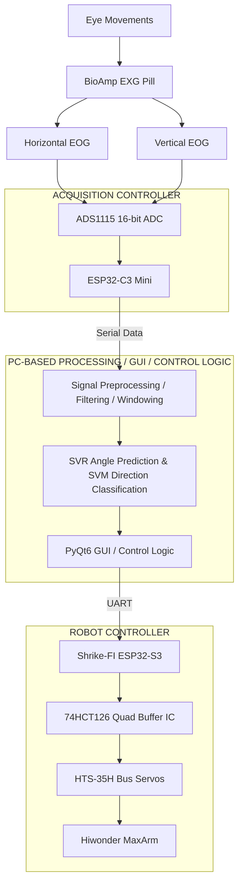

# BE Capstone Project

## 🎥 Project Demonstration [](https://youtu.be/LLZSEM22tTs?si=Ve9w69eN5hiVtP-J)

# EOG-Based Robotic Manipulator Control Using SVR Angle Prediction and SVM Direction Classification

## Project Overview

This project presents a machine-learning-based Electrooculography (EOG) control system designed to operate a robotic manipulator using eye movements. The system integrates EOG signal acquisition, chart-based dataset collection, Support Vector Regression (SVR), Support Vector Machine (SVM) classification, PCB design, real-time signal processing, and robotic hardware integration using the Hiwonder MaxArm robotic manipulator.

Unlike conventional camera-based eye-tracking systems, this approach uses electrical potential variations associated with eye movements to estimate viewing angles and identify directional actions. EOG measurements are acquired using the BioAmp EXG Pill and digitized through the ADS1115 analog-to-digital converter.

The acquisition system consists of an ADS1115 ADC and an ESP32-C3 Mini microcontroller. The acquired EOG measurements are transferred to a computer through serial communication for signal preprocessing, windowing, and machine-learning inference.

The collected dataset is used to train two machine-learning models. **Support Vector Regression (SVR)** predicts the corresponding eye movement angle, while **Support Vector Machine (SVM)** classifies eye movements into four directional actions: UP, DOWN, LEFT, and RIGHT.

The processed signals are passed to a PyQt6-based graphical user interface and control application. The predicted angle and classified direction are converted into robotic movement commands and transmitted through UART communication to the Shrike-FI ESP32-S3 robot controller.

The robot controller communicates with HTS-35H bus servos through a 74HCT126 buffer IC, enabling the Hiwonder MaxArm robotic manipulator to execute the corresponding movements.

The complete real-time control pipeline has been implemented and tested. The remaining development focuses on fine-tuning robot movement parameters to achieve smoother, more stable, and consistent movement.

---

## Table of Contents

- [Problem Statement](#problem-statement)
- [Project Objectives](#project-objectives)
- [Team Details](#team-details)
- [Guide Details](#guide-details)
- [Proposed System Architecture](#proposed-system-architecture)
- [Hardware Requirements](#hardware-requirements)
- [Software and Technologies](#software-and-technologies)
- [Working Methodology](#working-methodology)
- [Machine-Learning Approach](#machine-learning-approach)
- [Robotic Manipulator Integration](#robotic-manipulator-integration)
- [Communication Architecture](#communication-architecture)
- [Project Progress and Current Status](#project-progress-and-current-status)
- [Performance Evaluation](#performance-evaluation)
- [Limitations](#limitations)
- [Future Scope](#future-scope)
- [Conclusion](#conclusion)
- [References](#references)

---

## Problem Statement

Conventional eye-tracking systems often rely on cameras, infrared illumination, or dedicated commercial hardware, which can increase implementation cost and complexity. A low-cost alternative is desirable for translating eye movements into control commands for robotic applications.

Electrooculography provides a method of detecting eye movements by measuring electrical potential variations associated with changes in eye position. However, EOG signals can be affected by baseline drift, electrical interference, electrode placement, and individual physiological differences.

A calibrated data acquisition and machine-learning approach is therefore required to map EOG measurements to reference angles and directional commands.

The objective of this project is to develop an EOG-based robotic manipulator control system that uses SVR for angle prediction and SVM for directional classification, enabling eye-movement-based control of a Hiwonder MaxArm robotic manipulator.

---

## Project Objectives

- Develop an EOG-based human–machine interface for robotic manipulation.
- Acquire horizontal and vertical EOG signals using the BioAmp EXG Pill.
- Digitize the acquired signals using an ADS1115 ADC.
- Implement ESP32-C3 Mini-based EOG data acquisition.
- Transfer acquired EOG measurements to a computer through serial communication.
- Collect a labeled dataset using predefined points on a calibration chart.
- Associate recorded ADC measurements with their corresponding reference angles.
- Train an SVR model to predict eye movement angles.
- Train an SVM model to classify UP, DOWN, LEFT, and RIGHT actions.
- Implement signal preprocessing and windowing for real-time processing.
- Develop a PyQt6-based graphical user interface for monitoring and control.
- Design a PCB for the project hardware.
- Interface the PC-based control application with the Shrike-FI ESP32-S3 controller.
- Establish UART communication between the PC and robot controller.
- Use a 74HCT126 buffer IC in the servo communication interface.
- Interface HTS-35H bus servos with the Hiwonder MaxArm robotic manipulator.
- Integrate real-time machine-learning predictions with robotic movement commands.
- Fine-tune robotic movement parameters to achieve smooth and stable operation.

---

## Team Details

| Sr. No. | Name | Roll No. | Branch | Email ID |
|---|---|---:|---|---|
| 1 | Shrawan Rakesh Rane | 24 | Automation and Robotics | d2024.shrawan.rane@ves.ac.in |
| 2 | Vinod Santosh Kale | 05 | Automation and Robotics | d2024.vinod.kale@ves.ac.in |
| 3 | Dhanush Balasubramaian | 37 | Automation and Robotics | d2024.dhanush.balasubramanian@ves.ac.in |
| 4 | Rahul Kumar Yadav | 33 | Automation and Robotics | 2023.vinod.kale@ves.ac.in |

## Guide Details

- **Project Guides:** Dr. Sangeeta Prasannaram / Kader Shaikh
- **Department:** Automation and Robotics
- **Institute:** Vivekanand Education Society's Institute of Technology (VESIT), Mumbai, India

---

## Proposed System Architecture

The proposed system is divided into three major subsystems:

1. Acquisition Controller
2. PC-Based Processing / GUI / Control Logic
3. Robot Controller

The complete system operates through wired serial and UART communication. No wireless communication is used.

### 1. Acquisition Controller

The acquisition subsystem consists of the BioAmp EXG Pill, ADS1115 16-bit ADC, and ESP32-C3 Mini.

The BioAmp EXG Pill acquires electrical signals associated with horizontal and vertical eye movements. The ADS1115 digitizes the conditioned analog signals, and the ESP32-C3 Mini reads the ADC measurements and transfers them to the computer through serial communication.

### 2. PC-Based Processing / GUI / Control Logic

The computer performs signal preprocessing, filtering, and windowing of the acquired EOG measurements.

The processed signals are provided to the machine-learning models:

- **SVR:** Predicts the corresponding eye movement angle.
- **SVM:** Classifies the intended direction as UP, DOWN, LEFT, or RIGHT.

The predictions are processed by the PyQt6 graphical user interface and control logic. The application generates the corresponding robotic movement commands and transmits them to the robot controller through UART communication.

### 3. Robot Controller

The robot control subsystem consists of the Shrike-FI ESP32-S3, 74HCT126 quad buffer IC, HTS-35H bus servos, and Hiwonder MaxArm robotic manipulator.

The Shrike-FI receives movement commands from the PC through UART. It processes the commands and communicates with the HTS-35H bus servos through the 74HCT126 buffer interface.

The servos execute the corresponding movement commands, resulting in eye-movement-based robotic manipulation.

### System Architecture Diagram



**Current implementation status:** EOG acquisition, serial data transfer, PC-based signal processing, SVR angle prediction, SVM directional classification, PyQt6 GUI, UART communication, and robotic manipulator integration have been implemented and tested. Only final robot movement tuning remains.

---

## Hardware Requirements

| Component | Purpose |
|---|---|
| EOG Electrodes | Acquire electrical signals associated with eye movements |
| BioAmp EXG Pill | Amplify and condition EOG signals |
| ADS1115 16-bit ADC | Convert analog EOG signals into digital measurements |
| ESP32-C3 Mini | Acquire ADC measurements and transmit data to the computer |
| Computer/Laptop | Signal processing, machine-learning inference, GUI, and control logic |
| Shrike-FI ESP32-S3 | Receive robotic movement commands and control the servos |
| 74HCT126 Quad Buffer IC | Buffer and interface servo communication signals |
| HTS-35H Bus Servos | Execute the required robotic joint movements |
| Hiwonder MaxArm | Robotic manipulator for physical movement |
| PCB | Hardware interconnection and circuit implementation |
| Power Supply | Provide appropriate power to the robotic system |
| Connecting Wires | Establish electrical interconnections |

---

## Software and Technologies

| Technology | Purpose |
|---|---|
| Python | Signal processing and machine-learning implementation |
| NumPy | Numerical computation |
| Pandas | Dataset organization and analysis |
| Scikit-learn | SVR regression and SVM classification |
| SciPy | Signal filtering and processing |
| Matplotlib | Dataset visualization and signal plots |
| PyQt6 | Graphical user interface and robotic control application |
| Arduino IDE | ESP32 firmware development |
| ESP32 Arduino Core | Firmware development for ESP32-C3 and ESP32-S3 |
| Serial Communication | Transfer EOG acquisition data to the PC |
| UART Communication | Transfer robotic movement commands to the robot controller |

---

## Working Methodology

### 1. EOG Signal Acquisition

Surface electrodes acquire electrical potential variations associated with horizontal and vertical eye movements. The BioAmp EXG Pill conditions the acquired signals, which are digitized using the ADS1115 16-bit ADC.

The ESP32-C3 Mini reads the ADC measurements and transfers the acquired EOG data to the computer through serial communication.

The acquisition subsystem provides the input data required for dataset collection and real-time signal processing.

**Status: Completed.**

### 2. Chart-Based Dataset Collection

A calibration chart containing predefined points is used to collect labeled EOG measurements. During data collection, the user sits approximately **45 cm away from the chart** and looks at the designated points.

For each point, the corresponding ADC values are recorded and associated with the reference angle represented by that point. Directional labels are also assigned to the collected data for supervised classification.

This creates a labeled dataset containing EOG measurements, reference angles, and directional classes.

**Status: Completed.**

### 3. Dataset Preparation

The collected measurements are organized into input features and target labels.

- **Input features:** Acquired EOG ADC measurements or the selected EOG feature representation.
- **Regression target:** Corresponding reference angle.
- **Classification target:** Directional action — UP, DOWN, LEFT, or RIGHT.

The prepared dataset is used to train and test the machine-learning models.

**Status: Completed.**

### 4. PC-Based Signal Preprocessing and Windowing

The acquired EOG measurements are transferred to the computer through serial communication.

The PC-based processing application performs signal preprocessing, filtering, and windowing to prepare the acquired measurements for machine-learning inference.

Windowing divides the continuous EOG data into smaller segments that can be processed by the trained machine-learning models.

The processed signals are passed to the SVR and SVM models for angle prediction and directional classification.

**Status: Completed.**

### 5. SVR-Based Angle Prediction

Support Vector Regression is used to estimate the corresponding eye movement angle from EOG measurements.

The SVR model learns the relationship between recorded ADC values and the reference angles in the calibration dataset. Once trained, the model receives processed EOG input measurements and generates an angle prediction.

The predicted angle serves as an input to the robotic control application.

**Status: Completed.**

### 6. SVM-Based Direction Classification

A Support Vector Machine classifier identifies the directional action associated with the processed EOG input.

The four directional classes are:

- **UP**
- **DOWN**
- **LEFT**
- **RIGHT**

The predicted direction provides the directional component of the robotic control command.

**Status: Completed.**

### 7. Preliminary Model Testing

The initially trained SVR and SVM models were tested using their existing parameter configurations. The purpose of this stage was to observe the models' initial behavior and evaluate their angle-prediction and directional-classification performance.

This preliminary testing established a baseline for the implemented machine-learning models.

**Status: Completed.**

### 8. PCB Design

The printed circuit board design for the project hardware has been completed. The PCB forms part of the hardware development intended to support the EOG acquisition and control system.

**Status: PCB design completed.**

### 9. PyQt6 GUI and Control Logic

A PyQt6-based graphical user interface has been implemented for real-time monitoring and robotic control.

The application receives and processes the machine-learning predictions generated by the SVR and SVM models.

The control logic uses the predicted angle and classified direction to generate the corresponding robotic movement commands.

The application also provides an interface for monitoring the system and controlling the robotic manipulator.

**Status: Completed.**

### 10. UART-Based Robot Communication

The PC-based control application communicates with the Shrike-FI ESP32-S3 robot controller through UART.

The generated movement commands are transmitted from the computer to the Shrike-FI controller. The controller processes the received commands and communicates with the HTS-35H bus servos through the 74HCT126 buffer interface.

The system uses wired serial/UART communication. No wireless communication protocol is involved in the implemented architecture.

**Status: Completed.**

### 11. Robotic Manipulator Integration

The robotic control subsystem consists of the Shrike-FI ESP32-S3, 74HCT126 buffer IC, HTS-35H bus servos, and Hiwonder MaxArm robotic manipulator.

The implemented control sequence is:

1. Acquire horizontal and vertical EOG measurements.
2. Digitize the signals using the ADS1115 ADC.
3. Transfer the measurements to the PC using the ESP32-C3 Mini through serial communication.
4. Perform signal preprocessing and windowing on the computer.
5. Predict the corresponding angle using the trained SVR model.
6. Classify the intended direction using the trained SVM model.
7. Process the predictions through the PyQt6 GUI and control logic.
8. Generate the corresponding robotic movement command.
9. Transmit the command through UART to the Shrike-FI ESP32-S3.
10. Communicate with the HTS-35H bus servos through the 74HCT126 buffer interface.
11. Execute the requested movement using the Hiwonder MaxArm robotic manipulator.

The complete real-time pipeline has been implemented and tested, demonstrating eye-movement-based robotic control.

**Status: Completed.**

---

## Machine-Learning Approach

### Support Vector Regression (SVR)

SVR is used for the continuous angle-prediction task.

- **Input:** Processed EOG ADC measurements or the selected EOG feature representation.
- **Output:** Predicted reference angle.
- **Purpose:** Estimate the angle associated with the current EOG input.

The model learns a regression relationship between the input measurements and the labeled angles in the training dataset.

### Support Vector Machine (SVM)

SVM is used for directional classification.

- **Input:** Processed EOG ADC measurements or the selected EOG feature representation.
- **Output:** UP, DOWN, LEFT, or RIGHT.
- **Purpose:** Identify the directional action associated with the current EOG input.

### Combined Inference Workflow

```text
             EOG Measurements
                    |
                    v
             Data Acquisition
                    |
                    v
           Signal Preprocessing
                    |
                    v
                 Windowing
                    |
                    v
          Machine-Learning Inference
                    |
          +---------+---------+
          |                   |
          v                   v
    SVR Angle Prediction   SVM Direction Classification
          |                   |
          v                   v
    Predicted Angle      Predicted Direction
          |                   |
          +---------+---------+
                    |
                    v
           PyQt6 GUI / Control Logic
                    |
                    v
          Control Command Generation
                    |
                    v
           UART Communication
                    |
                    v
          Shrike-FI ESP32-S3
                    |
                    v
          74HCT126 Buffer Interface
                    |
                    v
             HTS-35H Servos
                    |
                    v
             Hiwonder MaxArm
                    |
                    v
               Robot Movement
```

The SVR and SVM models have been trained, tested, and integrated into the real-time robotic control application. Their outputs are processed to generate movement commands for the MaxArm robotic manipulator.

---

## Robotic Manipulator Integration

The robotic control subsystem consists of the Shrike-FI ESP32-S3 controller, 74HCT126 quad buffer IC, HTS-35H bus servos, and Hiwonder MaxArm robotic manipulator.

The PC-based control application generates movement commands using the SVR-predicted angle and SVM-classified direction.

These commands are transmitted through UART to the Shrike-FI ESP32-S3 controller. The controller communicates with the servo bus through the 74HCT126 buffer interface.

The HTS-35H bus servos receive the corresponding commands and execute the requested movements through the Hiwonder MaxArm robotic manipulator.

### Robot Control Sequence

1. Receive the generated movement command from the PC through UART.
2. Process the command using the Shrike-FI ESP32-S3.
3. Interface with the servo communication bus through the 74HCT126 buffer IC.
4. Transmit the corresponding servo position commands.
5. Execute the movement using the HTS-35H bus servos.
6. Produce the corresponding physical movement through the MaxArm robotic manipulator.

**Integration Status: Completed.**

The complete communication and robotic movement pipeline has been implemented and tested. The remaining activity is to fine-tune servo movement parameters to improve movement smoothness, stability, and consistency.

---

## Communication Architecture

The system uses wired serial and UART communication for transferring acquired EOG measurements and robotic movement commands.

### 1. Acquisition Controller to PC

The ESP32-C3 Mini reads the digitized EOG measurements from the ADS1115 ADC and transmits the acquired data to the computer through serial communication.

### 2. PC-Based Processing

The computer receives the serial data and performs signal preprocessing, windowing, SVR angle prediction, and SVM directional classification.

The PyQt6 application processes the model outputs and generates the corresponding robotic movement commands.

### 3. PC to Robot Controller

The generated movement commands are transmitted from the PC to the Shrike-FI ESP32-S3 through UART communication.

### 4. Robot Controller to Servos

The Shrike-FI ESP32-S3 communicates with the HTS-35H bus servos through the 74HCT126 quad buffer IC.

The servos execute the received movement commands, resulting in the corresponding robotic manipulator movement.

**Communication Status: Completed.**

All communication links required for the implemented real-time control system have been established and tested. The architecture does not use Wi-Fi, Bluetooth, ESP-NOW, or any other wireless communication method.

---

## Project Progress and Current Status

The project has progressed through EOG signal acquisition, dataset collection, machine-learning model development, PCB design, real-time processing, UART communication, and robotic manipulator integration.

The complete EOG-based robotic control system has been implemented and tested. The current focus is on improving the smoothness and stability of the robotic manipulator's movement.

### Completed Work

- [x] **EOG Signal Acquisition:** Acquired horizontal and vertical EOG measurements using the BioAmp EXG Pill.
- [x] **ADC Integration:** Integrated the ADS1115 16-bit ADC for digitizing the acquired EOG signals.
- [x] **Acquisition Controller:** Implemented ESP32-C3 Mini-based data acquisition and serial data transmission.
- [x] **EOG Dataset Collection:** Collected EOG ADC measurements using a predefined calibration chart, with the user positioned approximately 45 cm from the chart. Corresponding reference angles and directional labels were recorded for supervised learning.
- [x] **Dataset Preparation:** Organized and prepared the collected measurements for machine-learning training and testing.
- [x] **SVR Model Development:** Trained and implemented the SVR model for eye movement angle prediction.
- [x] **SVM Model Development:** Trained and implemented the SVM model for UP, DOWN, LEFT, and RIGHT directional classification.
- [x] **Machine-Learning Model Testing:** Tested the SVR and SVM models to evaluate their prediction and classification behavior.
- [x] **Signal Preprocessing:** Implemented PC-based signal preprocessing and filtering.
- [x] **Windowing:** Implemented data windowing for machine-learning inference.
- [x] **PCB Design:** Completed the printed circuit board design for the project hardware.
- [x] **PyQt6 GUI Development:** Developed the graphical user interface for real-time monitoring and robotic control.
- [x] **Real-Time SVR Integration:** Integrated SVR-based angle prediction into the real-time control application.
- [x] **Real-Time SVM Integration:** Integrated SVM-based directional classification into the real-time control application.
- [x] **Control Command Generation:** Implemented the conversion of predicted angles and classified directions into robotic movement commands.
- [x] **UART Communication:** Established communication between the PC-based control application and the Shrike-FI ESP32-S3 controller.
- [x] **Robot Controller Integration:** Integrated the Shrike-FI ESP32-S3 with the robotic servo communication interface.
- [x] **74HCT126 Buffer Integration:** Implemented the buffer interface for communication with the HTS-35H bus servos.
- [x] **Robotic Hardware Integration:** Integrated the HTS-35H bus servos with the Hiwonder MaxArm robotic manipulator.
- [x] **Real-Time Robot Movement Control:** Successfully transmitted movement commands to the MaxArm robotic manipulator and demonstrated eye-movement-based robotic control.
- [x] **Communication and Command Testing:** Verified the transmission and execution of robotic movement commands through the controller.

### Pending Work

- [ ] **Robot Movement Tuning:** Fine-tune the robotic manipulator's movement parameters, including servo response, movement speed, smoothing, and position transitions, to achieve smoother, more stable, and consistent movement with minimal jitter.

### Current Development Focus

The complete EOG-based robotic control system has been implemented, including signal acquisition, ADC integration, serial data transfer, signal preprocessing, windowing, SVR-based angle prediction, SVM-based directional classification, PyQt6 GUI development, UART communication, and robotic manipulator integration.

The current development phase focuses exclusively on **robot movement tuning** to improve movement smoothness, stability, and consistency during real-time operation.

**Current Milestone:** The complete EOG-based robotic manipulator control system is operational. Only final robot movement tuning to achieve smooth and stable operation remains pending.

---

## Performance Evaluation

The following metrics are used to evaluate the system.

| Parameter | Evaluation Method |
|---|---|
| SVR Angle Prediction | Mean Absolute Error (MAE) and Root Mean Squared Error (RMSE) |
| SVM Direction Classification | Accuracy, precision, recall, and F1-score |
| Directional Reliability | Correct directional commands divided by total test commands |
| System Response Time | Time from EOG input acquisition to command generation |
| End-to-End Latency | Time from input acquisition to observable robot response |
| Movement Repeatability | Consistency of robot position across repeated commands |
| Communication Reliability | Successful commands and valid servo responses |
| Movement Smoothness | Observation of servo jitter, speed consistency, and position transitions |

The SVR and SVM models have undergone preliminary testing, and the real-time robotic control system has been demonstrated.

Further evaluation will focus on robot movement smoothness, stability, repeatability, and overall response during operation.

Numerical performance values should only be reported when they have been measured and validated.

---

## Limitations

Potential limitations include:

- Variability in EOG signal amplitude between users.
- Baseline drift and electrical interference.
- Sensitivity to electrode placement and contact quality.
- Calibration errors caused by inconsistent gaze positioning.
- Limited model generalization if the dataset does not adequately cover the operating range.
- Classification errors during transitions between eye movements.
- Serial communication delays or failures between the computer and controller.
- Mechanical limitations and servo-positioning errors.
- Minor movement jitter and the need for further servo-response tuning.

Reliable operation depends on consistent calibration, representative training data, suitable signal processing, and robust hardware integration.

---

## Future Scope

Potential improvements include:

- Expanding the dataset to cover additional angles and intermediate positions.
- Improving signal preprocessing and artifact rejection.
- Developing adaptive calibration for different users.
- Comparing model performance across different recording sessions.
- Optimizing real-time inference and communication latency.
- Adding feedback-based correction using measured servo positions.
- Implementing robust movement limits and communication fault handling.
- Improving servo movement smoothness and position transitions.
- Evaluating the complete system under repeated real-time operating conditions.
- Extending the interface to additional robotic tasks.

---

## Conclusion

This project develops a machine-learning-based approach to robotic manipulation using Electrooculography. A chart-based calibration procedure is used to collect EOG ADC measurements and their corresponding reference angles at an approximate viewing distance of 45 cm.

The collected dataset supports two complementary prediction tasks: SVR estimates the angle associated with the EOG input, while SVM classifies the intended direction as UP, DOWN, LEFT, or RIGHT.

The acquired EOG measurements are digitized using the ADS1115 ADC and transferred through the ESP32-C3 Mini to the computer using serial communication. The PC performs signal preprocessing, windowing, and machine-learning inference. The PyQt6 GUI and control logic process the model predictions and generate corresponding robotic movement commands.

These commands are transmitted through UART to the Shrike-FI ESP32-S3 controller, which communicates with the HTS-35H bus servos through the 74HCT126 buffer interface to operate the Hiwonder MaxArm robotic manipulator.

Dataset collection, machine-learning model development, signal processing, PCB design, real-time model integration, UART communication, and robotic hardware integration have been completed. The complete eye-movement-based robotic control system has been implemented and demonstrated.

The final development activity focuses on robot movement tuning to achieve smoother, more stable, and consistent robotic operation.

By integrating biomedical signal acquisition, supervised machine learning, embedded control, serial communication, and robotic actuation, the project establishes a functional foundation for eye-movement-based human–robot interaction.

---

## References

1. Texas Instruments, *ADS1115 16-Bit Analog-to-Digital Converter Datasheet*.
2. Scikit-learn Documentation, *Support Vector Regression (SVR)*.
3. Scikit-learn Documentation, *Support Vector Machines (SVM)*.
4. NumPy Documentation.
5. Pandas Documentation.
6. SciPy Documentation.
7. Arduino Documentation.
8. Relevant research literature on EOG-based human–computer interaction and eye-movement-driven robotic control.

---

## Project Keywords

Electrooculography (EOG), Support Vector Regression (SVR), Support Vector Machine (SVM), Angle Prediction, Direction Classification, Machine Learning, ADS1115, ESP32-C3 Mini, ESP32-S3, Shrike-FI, UART Communication, PyQt6, MaxArm, Hiwonder, HTS-35H Bus Servos, 74HCT126, PCB Design, Human–Robot Interaction.
